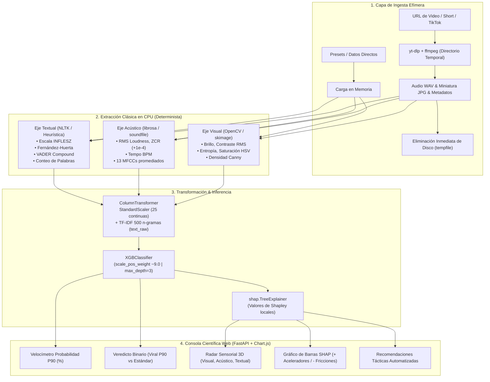

# ⚡ SonixPulse AI — Multimodal Virality Intelligence & SHAP Explainability Engine

[](https://www.python.org/)
[](https://fastapi.tiangolo.com/)
[](https://xgboost.readthedocs.io/)
[](https://shap.readthedocs.io/)
[](file:///c:/Users/usuario/Desktop/EPN/Semestres/QuintoSemestre/IA/Proyecto_Ideas/SonixPulse-AI/tests/test_multimodal_pipeline.py)

> **Plataforma de Auditoría y Predicción de Viralidad Multimodal para Contenido Digital**  
> Basada en la investigación técnica: *EPN: Arquitectura de Datos e Ingeniería de Características Clásicas para la Predicción de Viralidad Multimodal*.  
> Procesa la **Tríada Sensorial Mínima Viable** (Visual, Acústica y Lingüística) en CPU determinista, calibrada bajo el umbral de escape algorítmico **$P_{90}$** (proporción 90:10) con interpretabilidad **SHAP en tiempo real**.

---

## 📑 Tabla de Contenidos
1. [Visión General y Paradigma](#1-visión-general-y-paradigma)
2. [Ingeniería Matemática de las 25 Características Continuas](#2-ingeniería-matemática-de-las-25-características-continuas)
   - [Eje Visual (5 Características)](#21-eje-visual-5-características)
   - [Eje Acústico (16 Características)](#22-eje-acústico-16-características)
   - [Eje Textual / Lingüístico (4 Características + TF-IDF)](#23-eje-textual--lingüístico-4-características--tf-idf)
3. [Modelado Predictivo y Explicabilidad (XGBoost + SHAP)](#3-modelado-predictivo-y-explicabilidad-xgboost--shap)
   - [Justificación Teórica del Desbalance $P_{90}$](#31-justificación-teórica-del-desbalance-p90)
   - [Formulación Dinámica de `scale_pos_weight`](#32-formulación-dinámica-de-scale_pos_weight)
   - [Interpretabilidad Táctica con `shap.TreeExplainer`](#33-interpretabilidad-táctica-con-shaptreeexplainer)
4. [Arquitectura del Sistema y Pipeline End-to-End](#4-arquitectura-del-sistema-y-pipeline-end-to-end)
   - [Diagrama de Flujo del Pipeline](#41-diagrama-de-flujo-del-pipeline)
   - [Especificación de la API REST](#42-especificación-de-la-api-rest)
   - [Política de Ingesta Efímera y Fallback Resiliente](#43-política-de-ingesta-efímera-y-fallback-resiliente)
   - [Consola Científica Web Intercativa](#44-consola-científica-web-interactiva)
5. [Guía de Instalación, Pruebas y Despliegue](#5-guía-de-instalación-pruebas-y-despliegue)
6. [Estructura del Proyecto](#6-estructura-del-proyecto)

---

## 1. Visión General y Paradigma

### De SonixPulse Spotify a SonixPulse AI Multimodal
En versiones preliminares, **SonixPulse** operaba como un recomendador de nichos acústicos basado en clustering K-Means sobre metadatos de la Web API de Spotify. Aunque eficaz para análisis de catálogos comerciales, carecía de capacidad para evaluar la propagación de formatos de video corto (TikTok, YouTube Shorts, Reels), donde el impacto algorítmico depende de la correlación cruzada entre estímulos visuales, auditivos y verbales.

**SonixPulse AI** evoluciona hacia un motor de **auditoría y predicción de viralidad multimodal**, formalizando los principios analíticos desarrollados en la Escuela Politécnica Nacional (EPN). En lugar de depender de heurísticas subjetivas de curaduría, el sistema descompone cualquier pieza de contenido en **25 variables continuas normalizadas**, proyectándolas sobre una superficie de decisión matemática calibrada para detectar contenido ubicado en el **percentil 90 ($P_{90}$)** de propagación.

### El Principio "Fast-Track to Beta": Cero Deep Learning Pesado en CPU
El despliegue de redes neuronales convolucionales profundas (CNNs) o modelos de lenguaje masivos (LLMs multimodal) impone cuellos de botella severos: latencias de inferencia elevadas (>10 segundos por video), dependencia crítica de GPU (VRAM >8 GB) y costos computacionales prohibitivos en entornos de producción.

SonixPulse AI implementa la filosofía **Fast-Track to Beta**:
* **Tríada Sensorial Mínima Viable en CPU**: Procesamiento determinista y vectorizado mediante [OpenCV](https://opencv.org/), [scikit-image](https://scikit-image.org/), [librosa](https://librosa.org/) y [NLTK](https://www.nltk.org/). El cálculo completo de las 25 métricas se realiza en menos de **400 ms en CPUs estándar**.
* **Ingesta Efímera**: Descarga estrictamente en directorios temporales de memoria/disco volatil (`tempfile`), transformando el archivo a vectores matemáticos antes de su eliminación inmediata (garantía de huella de almacenamiento cero).
* **Explicabilidad SHAP en Tiempo Real**: Deducción de valores de Shapley mediante [`shap.TreeExplainer`](file:///c:/Users/usuario/Desktop/EPN/Semestres/QuintoSemestre/IA/Proyecto_Ideas/SonixPulse-AI/src/models/virality_explainer.py#L148-L152) en sub-milisegundos, permitiendo desglosar los aceleradores y fricciones del contenido en el frontend.

---

## 2. Ingeniería Matemática de las 25 Características Continuas

El espacio de entrada continuo está estructurado en tres tensores sensoriales que suman exactamente **25 características continuas**, implementadas en el paquete [`src.features`](file:///c:/Users/usuario/Desktop/EPN/Semestres/QuintoSemestre/IA/Proyecto_Ideas/SonixPulse-AI/src/features/__init__.py):

```
Vector de Entrada (25 features continuas):
├── Eje Visual (5 features)
├── Eje Acústico (16 features)
└── Eje Textual (4 features) + [Vector Disperso TF-IDF: 500 n-gramas]
```

### 2.1 Eje Visual (5 Características)
Módulo: [`src/features/visual_extractor.py`](file:///c:/Users/usuario/Desktop/EPN/Semestres/QuintoSemestre/IA/Proyecto_Ideas/SonixPulse-AI/src/features/visual_extractor.py)  
A partir de la miniatura o frame clave $I \in \mathbb{R}^{H \times W \times 3}$, se transforma la imagen al espacio de luminancia en escala de grises $I_{gray}(x, y) = 0.299 R + 0.587 G + 0.114 B$ y espacio HSV.

1. **Brillo Medio Ponderado (`visual_brightness_mean`)**:  
   Media aritmética de los valores de luminancia en el rango $[0, 255]$:
   $$\mu_{lum} = \frac{1}{H \cdot W} \sum_{x=1}^{W} \sum_{y=1}^{H} I_{gray}(x, y)$$

2. **Contraste RMS (`visual_contrast_rms`)**:  
   Desviación estándar de los niveles de gris, midiendo la dispersión de luminancia y profundidad dinámica de la toma:
   $$\sigma_{RMS} = \sqrt{\frac{1}{H \cdot W} \sum_{x=1}^{W} \sum_{y=1}^{H} \left(I_{gray}(x, y) - \mu_{lum}\right)^2}$$

3. **Entropía de Shannon del Color (`visual_color_entropy`)**:  
   Mide la riqueza de información y variedad cromática sobre el histograma marginal normalizado de 256 niveles con piso de regularización $\epsilon = 10^{-12}$:
   $$p_k = \frac{h_k}{\sum_{j=0}^{255} h_j + \epsilon}, \quad H_{color} = -\sum_{k: p_k > 0} p_k \log_2(p_k + 10^{-12})$$

4. **Saturación HSV Media (`visual_saturation_mean`)**:  
   Promedio del canal $S(x, y)$ en la descomposición cilíndrica HSV (escala $[0, 255]$):
   $$S(x, y) = \begin{cases} 0 & \text{si } \max(R,G,B) = 0 \\ \frac{\max(R,G,B) - \min(R,G,B)}{\max(R,G,B)} \times 255 & \text{en otro caso} \end{cases}, \quad \mu_{sat} = \frac{1}{H \cdot W} \sum_{x,y} S(x, y)$$

5. **Densidad de Bordes Canny (`visual_canny_edge_density`)**:  
   Filtro Gaussiano $G_{\sigma} (\sigma=1.0)$, gradiente Sobel bidireccional y supresión de no-máximos con histéresis (umbrales 50 y 150):
   $$\rho_{Canny} = \frac{1}{H \cdot W} \sum_{x=1}^{W} \sum_{y=1}^{H} \mathbb{I}\left(E_{Canny}(x, y) > 0\right)$$
   Representa la densidad de texturas, nitidez de contornos y complejidad gráfica.

---

### 2.2 Eje Acústico (16 Características)
Módulo: [`src/features/audio_extractor.py`](file:///c:/Users/usuario/Desktop/EPN/Semestres/QuintoSemestre/IA/Proyecto_Ideas/SonixPulse-AI/src/features/audio_extractor.py)  
El audio se estandariza a mono con frecuencia de muestreo $f_s = 22050\text{ Hz}$.

6. **Amplitud Media RMS / Loudness (`audio_rms_mean`)**:  
   Energía instantánea promedio en ventanas de análisis de tamaño $K=2048$ y salto $H=512$:
   $$x_{RMS}[m] = \sqrt{\frac{1}{K} \sum_{n=0}^{K-1} x[m \cdot H + n]^2}, \quad \bar{x}_{RMS} = \frac{1}{M} \sum_{m=0}^{M-1} x_{RMS}[m]$$

7. **Tasa de Cruces por Cero con Offset Estabilizador (`audio_zcr_mean`)**:  
   Frecuencia con la que la onda cambia de signo por unidad de frame, sumando un piso de estabilidad analítica $\delta = +10^{-4}$ para mitigar singularidades numéricas en silencios:
   $$\text{ZCR}[m] = \frac{1}{2(K-1)} \sum_{n=1}^{K-1} |\text{sgn}(x[n]) - \text{sgn}(x[n-1])|, \quad \bar{\text{ZCR}} = \left(\frac{1}{M}\sum_{m=0}^{M-1} \text{ZCR}[m]\right) + 10^{-4}$$

8. **Estimación del Tempo Rítmico en BPM (`audio_bpm_tempo`)**:  
   Cálculo del tempo dominante (Beats Per Minute) mediante autocorrelación de la curva de fuerza de inicios espectrales (*onset strength envelope*):
   $$\text{BPM} = \arg\max_{\tau} \sum_{m} O[m] \cdot O[m - \tau]$$

9–21. **13 Coeficientes Cepstrales en las Frecuencias de Mel (`audio_mfcc_1` a `audio_mfcc_13`)**:  
   Capturan la envolvente tímbrica espectral imitando la resolución perceptual de la cóclea humana:
   $$\bar{c}_i = \frac{1}{M} \sum_{m=0}^{M-1} c_i[m], \quad i \in \{1, 2, \dots, 13\}$$
   Donde cada $c_i[m]$ resulta de aplicar un banco de filtros triangulares en la escala Mel y la Transformada de Coseno Discreta ortogonal (DCT-II):
   $$c_i[m] = \sum_{k=0}^{P-1} \log(S_{Mel}[m, k]) \cos\left[\frac{\pi i}{P}\left(k + \frac{1}{2}\right)\right]$$

---

### 2.3 Eje Textual / Lingüístico (4 Características + TF-IDF)
Módulo: [`src/features/text_extractor.py`](file:///c:/Users/usuario/Desktop/EPN/Semestres/QuintoSemestre/IA/Proyecto_Ideas/SonixPulse-AI/src/features/text_extractor.py)  
Diseñado para analizar el gancho textual (*hook*, título o copy publicitario) en lengua española.

22. **Escala de Legibilidad INFLESZ (`text_inflesz_score`)**:  
    Adaptación científica de la fórmula Flesch para el español, evaluando la carga cognitiva:
    $$I_{INFLESZ} = 206.835 - 62.3 \left(\frac{N_{sil}}{N_{pal}}\right) - \left(\frac{N_{pal}}{N_{fras}}\right)$$
    *Interpretación*: $>80$ (Muy fácil / consumo ágil en redes), $60-80$ (Equilibrado), $<55$ (Denso / fricción de lectura).

23. **Índice de Fernández-Huerta (`text_fernandez_huerta_score`)**:  
    Segundo estándar métrico de inteligibilidad para textos en castellano:
    $$I_{FH} = 206.84 - 60.0 \left(\frac{N_{sil}}{N_{pal}}\right) - 1.02 \left(\frac{N_{pal}}{N_{fras}}\right)$$

24. **Polaridad de Sentimiento VADER Compound (`text_vader_compound`)**:  
    Intensidad afectiva calculada por el léxico VADER de NLTK normalizada en $[-1.0, +1.0]$:
    $$C = \frac{\sum v}{\sqrt{\left(\sum v\right)^2 + \alpha}}, \quad \alpha = 15$$
    Donde $v$ representa la valencia léxica de cada término detectado.

25. **Conteo de Palabras (`text_word_count`)**:  
    Extensión léxica total $N_{pal}$ medida como el número de tokens alfanuméricos en el texto.

* **Vectorización TF-IDF de Soporte (`text_raw`)**:  
  El texto sin procesar se transforma paralelamente mediante `TfidfVectorizer(max_features=500, ngram_range=(1, 2))` para capturar colocaciones y frases clave de enganche (p. ej. *"alerta de temazo"*, *"truco secreto"*, *"esto cambia todo"*).

---

## 3. Modelado Predictivo y Explicabilidad (XGBoost + SHAP)

### 3.1 Justificación Teórica del Desbalance $P_{90}$
En plataformas digitales de distribución algorítmica (TikTok, YouTube, Instagram), el volumen de reproducciones no sigue una distribución gaussiana simétrica, sino una distribución de cola pesada (*Heavy-Tailed / Pareto Distribution*). Aproximadamente el **90% del contenido publicado permanece en un rango de visualizaciones estándar**, mientras que solo el **10% superior supera el umbral de escape $P_{90}$**, activando ciclos de recomendación recursiva.

Para modelar esta dinámica real, el generador maestro ([`src/features/dataset_builder.py`](file:///c:/Users/usuario/Desktop/EPN/Semestres/QuintoSemestre/IA/Proyecto_Ideas/SonixPulse-AI/src/features/dataset_builder.py)) calibra una variable objetivo binaria estricta:
$$y_{clf} = \begin{cases} 1 & \text{si } \mathcal{S}_{latent} \ge \text{Percentil}_{90}(\mathcal{S}_{latent}) \quad (\approx 10\% \text{ Hits Virales}) \\ 0 & \text{en otro caso} \quad (\approx 90\% \text{ Contenido Estándar}) \end{cases}$$

### 3.2 Formulación Dinámica de `scale_pos_weight`
El entrenamiento convencional de minimización de entropía cruzada binaria sobre una proporción 90:10 induce a los modelos a converger en el clasificador trivial (predecir siempre 0, alcanzando un 90% de exactitud engañosa con recall nulo).

Para neutralizar este sesgo, [`src/models/virality_classifier.py`](file:///c:/Users/usuario/Desktop/EPN/Semestres/QuintoSemestre/IA/Proyecto_Ideas/SonixPulse-AI/src/models/virality_classifier.py) calcula dinámicamente el factor de ponderación sobre el conjunto de entrenamiento:
$$w_{pos} = \frac{\sum_{i=1}^{N_{train}} \mathbb{I}(y_i = 0)}{\sum_{i=1}^{N_{train}} \mathbb{I}(y_i = 1)} \approx 9.0$$

Incorporándose en la función de pérdida logarítmica de XGBoost:
$$\mathcal{L}_{logloss} = -\sum_{i=1}^{N} \left[ w_{pos} \cdot y_i \log(\hat{p}_i) + (1 - y_i) \log(1 - \hat{p}_i) \right]$$

Esta penalización simétrica obliga a los árboles de decisión a ponderar los falsos negativos con una severidad 9 veces mayor, logrando una frontera de discriminación balanceada (ROC-AUC $>0.85$ y F1 representativo).

```python
# Extracto de configuración en src/models/virality_classifier.py
classifier = XGBClassifier(
    n_estimators=100,
    max_depth=3,
    learning_rate=0.1,
    eval_metric="logloss",
    scale_pos_weight=scale_pos_weight,  # ~9.0 dinámico
    random_state=42
)
```

---

### 3.3 Interpretabilidad Táctica con `shap.TreeExplainer`
Módulo: [`src/models/virality_explainer.py`](file:///c:/Users/usuario/Desktop/EPN/Semestres/QuintoSemestre/IA/Proyecto_Ideas/SonixPulse-AI/src/models/virality_explainer.py)

SonixPulse AI descarta las predicciones opacas tipo *caja negra*. Emplea la teoría de juegos cooperativos mediante `shap.TreeExplainer`, computando los valores de Shapley $\phi_j(x)$ para cada una de las variables del espacio transformado:
$$f(x) = \phi_0 + \sum_{j=1}^{M} \phi_j(x)$$

Donde $\phi_0$ representa el valor base esperado (*base value* en log-odds) y $\phi_j$ el aporte marginal atribuido a la característica $j$:

* **Aceleradores de Viralidad ($\phi_j > 0$)**: Características que empujan la predicción hacia la superación de la barrera $P_{90}$ (p. ej. contraste visual elevado, RMS acústico competitivo, alta polaridad de sentimiento).
* **Puntos de Fricción ($\phi_j < 0$)**: Parámetros que frenan el alcance del contenido (p. ej. gancho de lectura complejo con bajo INFLESZ, saturación de color deficiente, tempo desfasado de los 120 BPM).

#### Mapeo a Recomendaciones Accionables
El motor traduce automáticamente los valores numéricos de Shapley a pautas operativas para creadores de contenido y marcas publicitarias:
* Si $\phi_{contrast} < 0 \implies$ *"Bajo contraste visual; incrementa la iluminación y la diferencia tonal entre planos iniciales."*
* Si $\phi_{inflesz} < 0 \implies$ *"Gancho con sintaxis densa; simplifica las oraciones para lectura rápida en pantallas pequeñas."*
* Si $\phi_{rms} < 0 \implies$ *"Volumen percibido bajo; masteriza el audio a -14 a -9 LUFS para mayor presencia sonora."*

#### Normalización para el Radar Sensorial 3D
Las contribuciones SHAP agregadas por cada eje sensorial se transforman mediante una función sigmoide logística escalada para generar puntuaciones de 0 a 100:
$$\text{Score}_{eje} = \text{clip}\left(\frac{100}{1 + \exp\left(-1.5 \sum_{j \in eje} \phi_j\right)}, 5.0, 98.0\right)$$

---

## 4. Arquitectura del Sistema y Pipeline End-to-End

### 4.1 Diagrama de Flujo del Pipeline



---

### 4.2 Especificación de la API REST
Servidor implementado con FastAPI en [`src/api/main.py`](file:///c:/Users/usuario/Desktop/EPN/Semestres/QuintoSemestre/IA/Proyecto_Ideas/SonixPulse-AI/src/api/main.py).

#### 1. Verificación de Salud (`GET /api/health`)
* **Descripción**: Confirma el estado operativo del microservicio y la presencia del modelo entrenado en disco.
* **Respuesta de Ejemplo (`200 OK`)**:
```json
{
  "status": "healthy",
  "service": "SonixPulse AI Multimodal Virality Engine",
  "version": "3.0.0-beta",
  "model_loaded": true,
  "model_artifact": "virality_xgb_model.joblib",
  "model_path": "C:\\...\\models\\virality_xgb_model.joblib",
  "features_count": 25,
  "p90_calibrated": true
}
```

#### 2. Inferencia y Explicabilidad (`POST /api/predict-virality`)
* **Descripción**: Recibe una URL pública, un preset o un texto, ejecutando la ingesta, clasificación y explicabilidad.
* **Cuerpo de Solicitud (JSON)**:
```json
{
  "url": "https://www.youtube.com/watch?v=dQw4w9WgXcQ",
  "preset": null,
  "text": null
}
```
*Opcionalmente por preset*: `{"preset": "viral_hit"}` (`"viral_hit"`, `"podcast"`, `"indie_melancholic"`).

* **Respuesta de Ejemplo (`200 OK`)**:
```json
{
  "success": true,
  "url": "https://www.youtube.com/watch?v=dQw4w9WgXcQ",
  "probability": 0.8412,
  "probability_percentage": 84.1,
  "is_viral_p90": true,
  "radar_scores": {
    "visual": 76.5,
    "acoustic": 89.2,
    "textual": 68.0
  },
  "top_positive_factors": [
    {
      "feature": "num__audio_rms_mean",
      "clean_name": "audio_rms_mean",
      "shap_value": 0.7241,
      "impact": "positive"
    },
    {
      "feature": "num__visual_contrast_rms",
      "clean_name": "visual_contrast_rms",
      "shap_value": 0.5123,
      "impact": "positive"
    }
  ],
  "top_negative_factors": [
    {
      "feature": "num__text_inflesz_score",
      "clean_name": "text_inflesz_score",
      "shap_value": -0.2185,
      "impact": "negative"
    }
  ],
  "recommendations": [
    "[Fricción táctica] Gancho con sintaxis densa; simplifica las oraciones para lectura rápida en pantallas pequeñas.",
    "[Fortaleza clave] Presión acústica (RMS/Loudness) competitiva con los estándares virales de TikTok/Reels.",
    "[Fortaleza clave] Excelente rango dinámico y contraste visual; favorece la retención visual sostenida."
  ],
  "fallback_applied": false,
  "fallback_reason": null
}
```

---

### 4.3 Política de Ingesta Efímera y Fallback Resiliente
Módulo: [`src/ingestion/multimodal_ingestion.py`](file:///c:/Users/usuario/Desktop/EPN/Semestres/QuintoSemestre/IA/Proyecto_Ideas/SonixPulse-AI/src/ingestion/multimodal_ingestion.py)

* **Ejecución en Sandbox Efímero**: Se utiliza `tempfile.TemporaryDirectory()`. El audio es extraído en formato `.wav` a 192 kbps y la carátula en `.jpg` mediante `yt-dlp` enlazado al binario `ffmpeg`. Al cerrarse el contexto, el sistema operativo limpia todos los archivos inmediatamente.
* **Resiliencia ante Anti-Bot y Errores de Red**: Si la plataforma de origen activa bloqueos anti-scraping, desafíos CAPTCHA o restricciones de video privado, la excepción es capturada sin disparar errores HTTP 500. El ingestor activa automáticamente el **mecanismo de fallback transparente** (`fallback_applied: true`), inyectando las características por defecto del sistema y permitiendo que la API devuelva una respuesta determinista con el diagnóstico correspondiente.

---

### 4.4 Consola Científica Web Interactiva
Archivos: [`web/index.html`](file:///c:/Users/usuario/Desktop/EPN/Semestres/QuintoSemestre/IA/Proyecto_Ideas/SonixPulse-AI/web/index.html) y [`index.html`](file:///c:/Users/usuario/Desktop/EPN/Semestres/QuintoSemestre/IA/Proyecto_Ideas/SonixPulse-AI/index.html)

La consola presenta una interfaz oscura de estilo *DeepMind / Laboratorio Científico*:
* **Velocímetro Circular de Probabilidad $P_{90}$**: Muestra el porcentaje de probabilidad y una etiqueta de veredicto en tiempo real (*"VIRAL P90 SUPERADO"* en esmeralda o *"CONTENIDO ESTÁNDAR"* en gris azulado).
* **Radar Sensorial 3D (Chart.js)**: Gráfico polar de 3 ejes (Visual, Acústico y Textual) que contrasta el equilibrio del contenido contra el perfil óptimo de un Hit Viral.
* **Gráfico de Barras SHAP (+ / -)**: Renderiza las contribuciones relativas en verde (factores positivos que aceleran la viralidad) y carmesí (factores negativos que actúan como puntos de fricción).
* **Presets Rápidos de Auditoría**: Botones de prueba instantánea con perfiles pre-calibrados:
  - *Hit Viral de Alto Impacto* (probabilidad $>80\%$).
  - *Podcast Conversacional Sobrecargado* (probabilidad $<25\%$).
  - *Música Indie Melancólica* (probabilidad $<35\%$).

---

## 5. Guía de Instalación, Pruebas y Despliegue

### 5.1 Requisitos del Sistema
* **Python**: Versión 3.11.x (verificado en Python 3.11.9).
* **FFmpeg**: Requerido para la extracción de audio y miniaturas vía `yt-dlp`.  
  *En Windows, instalable mediante Chocolatey (`choco install ffmpeg`) o WinGet (`winget install Gyan.FFmpeg`).*
* **Sistema Operativo**: Windows 10/11, Ubuntu 20.04/22.04 LTS o macOS.

---

### 5.2 Creación y Activación del Entorno Virtual (`.venv`)

#### En Windows (PowerShell):
```powershell
# 1. Clonar o ubicarse en la raíz del proyecto
cd C:\Users\usuario\Desktop\EPN\Semestres\QuintoSemestre\IA\Proyecto_Ideas\SonixPulse-AI

# 2. Crear el entorno virtual con Python 3.11
python -m venv .venv

# 3. Habilitar ejecución de scripts y activar entorno
Set-ExecutionPolicy -Scope Process -ExecutionPolicy Bypass
.\.venv\Scripts\Activate.ps1
```

#### En Linux / macOS (Bash / Zsh):
```bash
# 1. Crear el entorno virtual
python3 -m venv .venv

# 2. Activar el entorno
source .venv/bin/activate
```

---

### 5.3 Instalación de Dependencias y Léxico NLTK

```bash
# 1. Actualizar gestor pip
pip install --upgrade pip

# 2. Instalar dependencias fijadas en requirements.txt
pip install -r requirements.txt

# 3. Descargar el léxico VADER para análisis de sentimiento en texto
python -c "import nltk; nltk.download('vader_lexicon', quiet=True)"
```

---

### 5.4 Construcción del Dataset y Entrenamiento del Modelo

El modelo y el dataset maestro pueden reconstruirse en menos de 5 segundos de forma completamente determinista:

```bash
# 1. Generar el Dataset Maestro Multimodal Calibrado P90 (200 muestras)
python src/features/dataset_builder.py
# Genera: data/processed/multimodal_master_dataset.csv

# 2. Entrenar el clasificador XGBoost con scale_pos_weight dinámico y serializar artefacto
python src/models/virality_classifier.py
# Genera: models/virality_xgb_model.joblib
```

---

### 5.5 Ejecución de la Suite de Pruebas Automatizadas

La suite unificada valida la extracción visual, acústica, textual, la inferencia XGBoost/SHAP y el endpoint de la API:

```bash
# Ejecución con pytest en el entorno virtual
pytest tests/test_multimodal_pipeline.py -v
```

*Resultado esperado*:
```
tests/test_multimodal_pipeline.py::TestMultimodalPipeline::test_01_visual_extractor_synthetic PASSED
tests/test_multimodal_pipeline.py::TestMultimodalPipeline::test_02_audio_extractor_synthetic PASSED
tests/test_multimodal_pipeline.py::TestMultimodalPipeline::test_03_text_extractor_heuristics PASSED
tests/test_multimodal_pipeline.py::TestMultimodalPipeline::test_04_virality_classifier_and_shap_explainer PASSED
tests/test_multimodal_pipeline.py::TestMultimodalPipeline::test_05_api_endpoint_prediction PASSED
============================== 5 passed in 4.5s ==============================
```

---

### 5.6 Arranque del Servidor API y Dashboard Web

```bash
# Iniciar el servidor FastAPI con recarga automática en el puerto 8000
python src/api/main.py
```

* El servidor quedará disponible en: **`http://127.0.0.1:8000/`**
* Abre tu navegador web en **`http://127.0.0.1:8000/`** para interactuar con la **Consola Científica Web**.
* Documentación interactiva Swagger UI disponible en: **`http://127.0.0.1:8000/docs`**.

---

## 6. Estructura del Repositorio

```
SonixPulse-AI/
├── data/
│   └── processed/
│       └── multimodal_master_dataset.csv   # Dataset maestro calibrado P90 (25 features + text_raw + y_clf)
├── docs/                                   # Documentación técnica adicional y referencias
├── models/
│   └── virality_xgb_model.joblib           # Artefacto serializado (Pipeline + XGBoost + metadatos)
├── src/
│   ├── api/
│   │   └── main.py                         # Servidor FastAPI REST y montaje del frontend estático
│   ├── features/
│   │   ├── __init__.py                     # Exportación de listas canónicas de características
│   │   ├── visual_extractor.py             # 5 características visuales en CPU (OpenCV/skimage)
│   │   ├── audio_extractor.py              # 16 características acústicas en CPU (librosa/MFCCs)
│   │   ├── text_extractor.py               # 4 características textuales (INFLESZ, FH, VADER)
│   │   └── dataset_builder.py              # Generador determinista y calibrador P90
│   ├── ingestion/
│   │   ├── __init__.py
│   │   └── multimodal_ingestion.py         # Ingesta efímera con yt-dlp y ffmpeg con fallback
│   ├── models/
│   │   ├── __init__.py
│   │   ├── virality_classifier.py          # Entrenamiento de XGBClassifier con scale_pos_weight
│   │   └── virality_explainer.py           # Interpretabilidad SHAP TreeExplainer en tiempo real
│   └── nlp/
│       └── lyric_sentiment.py              # Módulo de apoyo NLP legacy
├── tests/
│   └── test_multimodal_pipeline.py         # Suite completa de 5 pruebas unitarias e integración
├── web/
│   └── index.html                          # Consola Científica Web completa (Chart.js + Dark Mode)
├── index.html                              # Copia raíz del dashboard web interactivo
├── plan_beta_multimodal_virality.md        # Plan de especificación del Fast-Track to Beta
├── requirements.txt                        # Especificación de dependencias fijadas de Python
└── README.md                               # Documentación técnica integral del proyecto
```

---

## 🔬 Referencias y Créditos Académicos
* **Investigación**: *EPN: Arquitectura de Datos e Ingeniería de Características Clásicas para la Predicción de Viralidad Multimodal*. Escuela Politécnica Nacional (EPN), 2026.
* **Librerías Principales**: [XGBoost](https://github.com/dmlc/xgboost), [SHAP (SHapley Additive exPlanations)](https://github.com/shap/shap), [Librosa](https://github.com/librosa/librosa), [FastAPI](https://github.com/tiangolo/fastapi).
