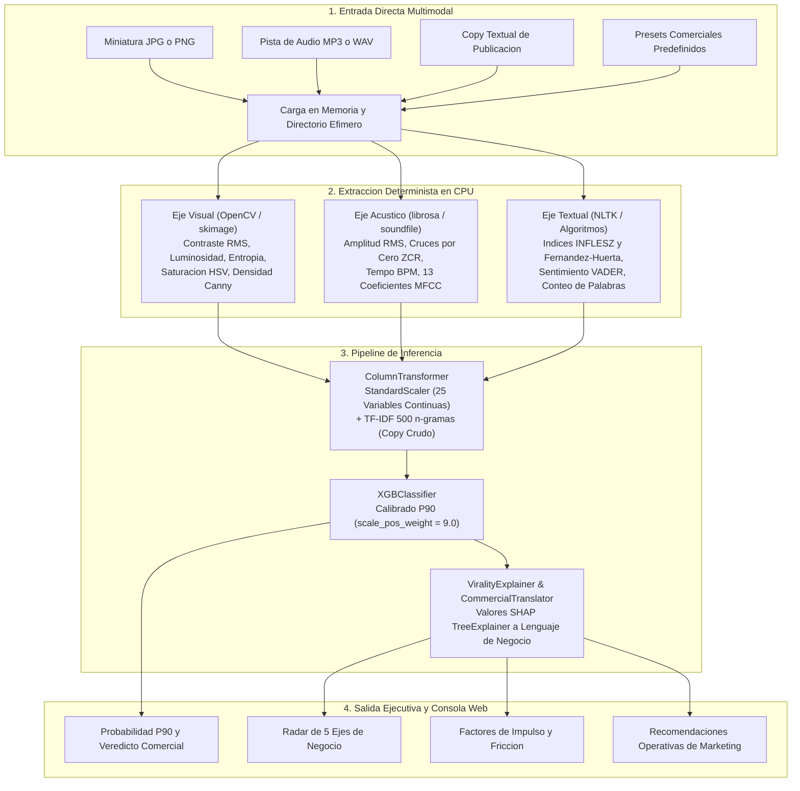

# SonixPulse AI - Motor Multimodal de Auditoria Predictiva y Explicabilidad Comercial

[](https://www.python.org/)
[](https://fastapi.tiangolo.com/)
[](https://xgboost.readthedocs.io/)
[](https://shap.readthedocs.io/)
[](tests/test_multimodal_pipeline.py)

SonixPulse AI es una herramienta de auditoria predictiva para creadores de contenido, marcas y agencias de marketing digital. Su funcion operativa consiste en evaluar si la combinacion de una Imagen de Portada, una Pista de Audio y un Copy Textual cuenta con la fuerza y sinergia necesarias para superar el percentil 90 (P90) de traccion digital antes de publicar en plataformas de formato corto (TikTok, Instagram Reels, YouTube Shorts).

A traves de un pipeline analitico determinista en CPU, el sistema procesa 25 variables continuas normalizadas y 500 n-gramas textuales, proyectando las decisiones sobre un modelo XGBoost ajustado para distribuciones asimetricas (90:10). Ademas, traduce las atribuciones locales de Shapley (SHAP) a un Radar Comercial de 5 Ejes e informes de factores de impulso y friccion con recomendaciones de negocio directas.

---

## Tabla de Contenidos

1. [Propuesta de Valor Comercial](#1-propuesta-de-valor-comercial)
2. [Entrada Directa Multimodal y Procesamiento Efimero](#2-entrada-directa-multimodal-y-procesamiento-efimero)
3. [Radar Comercial de 5 Ejes](#3-radar-comercial-de-5-ejes)
4. [Ingenieria Matematica de las 25 Caracteristicas Continuas](#4-ingenieria-matematica-de-las-25-caracteristicas-continuas)
   - [4.1 Eje Visual (5 Caracteristicas)](#41-eje-visual-5-caracteristicas)
   - [4.2 Eje Acustico (16 Caracteristicas)](#42-eje-acustico-16-caracteristicas)
   - [4.3 Eje Textual y Soporte Lexico (4 Caracteristicas + TF-IDF)](#43-eje-textual-y-soporte-lexico-4-caracteristicas--tf-idf)
5. [Modelado Predictivo y Desbalance 90:10 con XGBoost](#5-modelado-predictivo-y-desbalance-9010-con-xgboost)
   - [5.1 Justificacion del Umbral de Traccion P90](#51-justificacion-del-umbral-de-traccion-p90)
   - [5.2 Calibracion Dinamica con scale_pos_weight](#52-calibracion-dinamica-con-scale_pos_weight)
6. [Interpretabilidad Comercial con SHAP](#6-interpretabilidad-comercial-con-shap)
   - [6.1 Deduccion de Valores de Shapley](#61-deduccion-de-valores-de-shapley)
   - [6.2 Factores de Impulso y Factores de Friccion](#62-factores-de-impulso-y-factores-de-friccion)
   - [6.3 Traduccion de Negocio y Recomendaciones Operativas](#63-traduccion-de-negocio-y-recomendaciones-operativas)
7. [Arquitectura Tecnica Modular](#7-arquitectura-tecnica-modular)
   - [7.1 Flujo End-to-End del Pipeline](#71-flujo-end-to-end-del-pipeline)
   - [7.2 Especificacion de la API REST](#72-especificacion-de-la-api-rest)
   - [7.3 Dashboard Web Interactivo](#73-dashboard-web-interactivo)
8. [Guia de Instalacion y Puesta en Marcha](#8-guia-de-instalacion-y-puesta-en-marcha)
   - [8.1 Requisitos del Sistema](#81-requisitos-del-sistema)
   - [8.2 Configuracion del Entorno Virtual (.venv)](#82-configuracion-del-entorno-virtual-venv)
   - [8.3 Instalacion de Dependencias y Modelos Lexicos](#83-instalacion-de-dependencias-y-modelos-lexicos)
   - [8.4 Reconstruccion de Datos y Modelo](#84-reconstruccion-de-datos-y-modelo)
   - [8.5 Ejecucion de Pruebas Automatizadas](#85-ejecucion-de-pruebas-automatizadas)
   - [8.6 Arranque del Servicio API y Panel de Control](#86-arranque-del-servicio-api-y-panel-de-control)
9. [Estructura del Proyecto](#9-estructura-del-proyecto)

---

## 1. Propuesta de Valor Comercial

La mayoria de los equipos de creacion de contenido y agencias publicitarias operan a ciegas: publican piezas multimedia confiando en intuiciones esteticas o formulas genericas, descubriendo su rendimiento semanas despues de agotar el presupuesto de pauta o la atencion de su audiencia.

SonixPulse AI resuelve este problema introduciendo una auditoria previa al lanzamiento. Evalua si los tres componentes fundamentales de un contenido digital (miniatura visual, pista sonora y copy del titular) construyen una sinergia equilibrada o si, por el contrario, contienen fricciones que frenaran su alcance.

El objetivo central de la herramienta no es predecir un numero arbitrario de reproducciones, sino clasificar si la publicacion tiene las propiedades requeridas para romper la inercia algoritmica y posicionarse en el percentil 90 (P90) de interaccion. Al proveer diagnosticos cuantitativos y recomendaciones operativas antes de oprimir el boton de publicar, los equipos reducen el desperdicio de produccion y optimizan la efectividad de sus campanas.

---

## 2. Entrada Directa Multimodal y Procesamiento Efimero

El motor admite la carga directa de tres insumos independientes mediante formularios web o solicitudes multipart en la API REST:

1. **Miniatura o Imagen de Portada**: Formatos estandar JPG, PNG o WEBP. Representa el impacto optico inicial que detiene el scroll en el feed.
2. **Pista de Audio**: Archivos sonoros MP3 o WAV. Analiza la fuerza y la estructura ritmica que retiene al espectador durante los primeros segundos.
3. **Copy Textual**: Texto publicitario, titular de portada o descripcion de la publicacion. Evalua la carga cognitiva y el tono del mensaje.

Adicionalmente, la plataforma incorpora tres perfiles precalibrados (Campana Comercial, Hit Ritmico y Podcast Conversacional) para permitir auditorias instantaneas de contraste y calibracion de referencia.

### Politica de Manejo Efimero de Datos

A diferencia de sistemas que almacenan medios pesados en bases de datos o discos persistentes, SonixPulse AI implementa un protocolo estricto de retencion cero:

- **Recepcion Volatil**: Los archivos recibidos se depositan temporalmente en la carpeta `temp_uploads/` bajo identificadores unicos UUID.
- **Conversion Inmediata a Tensores**: Los extractores analizan las matrices numericas (pixeles y senales de audio) directamente en memoria RAM.
- **Borrado Garantizado en Disco**: Una vez construido el vector de caracteristicas, un bloque de control `finally` remueve los archivos fisicos de inmediato, sin importar si la solicitud concluyo con exito o presento advertencias. No existe persistencia de imagenes ni audios de los usuarios en el servidor.

---

## 3. Radar Comercial de 5 Ejes

Las 25 variables tecnicas de ingenieria resultan excesivamente densas para una conversacion comercial de marketing. Por esta razon, el modulo `CommercialTranslator` proyecta dichas metricas sobre un Radar Comercial de 5 Dimensiones de Negocio, normalizadas en una escala transparente de 0 a 100 puntos:

### 1. Atractivo Visual
Mide la capacidad de la imagen de portada para competir por atencion en pantallas de alta densidad. Combina la fuerza del contraste dinamico (30%), la saturacion cromatica (30%), la riqueza y variedad visual calculada por entropia (20%) y la nitidez de bordes Canny (20%).
- *Puntaje alto (>75)*: Imagen nitida, colores vivos y separacion clara entre sujeto y fondo.
- *Puntaje bajo (<50)*: Imagen plana, oscura o borrosa, propensa a ser descartada de inmediato.

### 2. Energia y Ritmo
Sintetiza la potencia acustica y la estructura temporal de la pista musical o locucion. Pondera en partes iguales la sonoridad RMS (50%) y la cadencia ritmica en pulsos por minuto (50%). La metrica de tempo premia de forma no lineal la ventana dinamica de 115 a 135 BPM (con centro optimo en 125 BPM), penalizando pistas lentas o ritmos acelerados sin estructura clara.
- *Puntaje alto (>75)*: Volumen competitivo con presencia en altavoces moviles y ritmo envolvente.
- *Puntaje bajo (<50)*: Audio apagado o cadencia monotona que reduce el dinamismo del contenido.

### 3. Claridad del Mensaje
Determina el esfuerzo mental que exige el texto para ser comprendido durante una visualizacion rapida. Se obtiene a partir del promedio ponderado de los indices de legibilidad INFLESZ (50%) y Fernandez-Huerta (50%), adaptados a la morfologia sintactica del idioma espanol.
- *Puntaje alto (>75)*: Frases cortas, lexico accesible y lectura fluida en menos de tres segundos.
- *Puntaje bajo (<50)*: Estructuras subordinadas largas o vocabulario denso que frenan la comprension.

### 4. Conexion Emocional
Evalua la intensidad de senales afectivas presentes en la publicacion. Integra la magnitud absoluta de la polaridad sentimental del texto (60%) calculada mediante VADER con la intensidad de saturacion cromatica (40%). Este eje detecta si la pieza apela a emociones definidas (entusiasmo, urgencia o contraste positivo) o si adopta una postura neutra y pasiva.
- *Puntaje alto (>70)*: Mensaje con tono marcado y tonalidades que evocan impacto expresivo.
- *Puntaje bajo (<45)*: Redaccion excesivamente tecnica o neutral combinada con colores apagados.

### 5. Retencion Estimada
Indice compuesto disenado para estimar la probabilidad de que la audiencia consuma el contenido completo en lugar de saltar hacia la siguiente publicacion. Integra el dinamismo sonoro global (amplitud RMS y presencia de altas frecuencias ZCR, 40%), el atractivo visual general (35%) y la concision cuantitativa del texto (25%), reconociendo una ventana optima de 8 a 25 palabras en el titular o copy.
- *Puntaje alto (>75)*: Estimulo sensorial balanceado que minimiza los puntos muertos.
- *Puntaje bajo (<50)*: Desfase evidente entre los componentes o extension de texto que satura al usuario.

---

## 4. Ingenieria Matematica de las 25 Caracteristicas Continuas

El vector continuo de entrada esta conformado por 25 metricas deterministas estructuradas en tres ejes sensoriales, procesadas mediante librerias optimizadas en CPU (OpenCV, librosa, NLTK):

```
Vector Continuo (25 metricas)
├── Eje Visual (5 metricas)
├── Eje Acustico (16 metricas)
└── Eje Textual (4 metricas) + Vector Disperso TF-IDF (500 n-gramas)
```

### 4.1 Eje Visual (5 Caracteristicas)
Implementado en `src/features/visual_extractor.py`. A partir de la matriz de imagen en espacio RGB, se extrae el canal de luminancia en escala de grises $I_{gray}(x, y) = 0.299 R + 0.587 G + 0.114 B$ y el espacio cilindrico HSV.

1. **Luminosidad Media (`visual_brightness_mean`)**:  
   Promedio de iluminacion de los pixeles sobre el area total $H \times W$:
   $$\mu_{lum} = \frac{1}{H \cdot W} \sum_{x=1}^{W} \sum_{y=1}^{H} I_{gray}(x, y)$$

2. **Contraste RMS (`visual_contrast_rms`)**:  
   Desviacion estandar de la intensidad luminosa, indicativa de separacion tonal y dinamismo:
   $$\sigma_{RMS} = \sqrt{\frac{1}{H \cdot W} \sum_{x=1}^{W} \sum_{y=1}^{H} \left(I_{gray}(x, y) - \mu_{lum}\right)^2}$$

3. **Entropia Cromatica de Shannon (`visual_color_entropy`)**:  
   Medida de variedad de distribucion de color a partir del histograma marginal de 256 niveles con regularizacion $\epsilon = 10^{-12}$:
   $$p_k = \frac{h_k}{\sum_{j=0}^{255} h_j + \epsilon}, \quad H_{color} = -\sum_{k: p_k > 0} p_k \log_2(p_k + 10^{-12})$$

4. **Saturacion HSV Promedio (`visual_saturation_mean`)**:  
   Intensidad cromatica media del canal $S(x, y)$ normalizado en la escala $[0, 255]$:
   $$S(x, y) = \frac{\max(R,G,B) - \min(R,G,B)}{\max(R,G,B) + \epsilon} \times 255, \quad \mu_{sat} = \frac{1}{H \cdot W} \sum_{x,y} S(x, y)$$

5. **Densidad de Bordes Canny (`visual_canny_edge_density`)**:  
   Proporcion de pixeles que corresponden a transiciones abruptas y bordes definidos tras aplicar filtro Gaussiano ($\sigma=1.0$) y doble umbralizacion (50 y 150):
   $$\rho_{Canny} = \frac{1}{H \cdot W} \sum_{x=1}^{W} \sum_{y=1}^{H} \mathbb{I}\left(E_{Canny}(x, y) > 0\right)$$

### 4.2 Eje Acustico (16 Caracteristicas)
Implementado en `src/features/audio_extractor.py`. La pista sonora se estandariza a canal mono con frecuencia de muestreo $f_s = 22050\text{ Hz}$.

6. **Amplitud Media Cuadratica RMS (`audio_rms_mean`)**:  
   Presion sonora promediada en ventanas de analisis de $K=2048$ muestras y salto $H=512$:
   $$\bar{x}_{RMS} = \frac{1}{M} \sum_{m=0}^{M-1} \sqrt{\frac{1}{K} \sum_{n=0}^{K-1} x[m \cdot H + n]^2}$$

7. **Tasa de Cruces por Cero con Offset (`audio_zcr_mean`)**:  
   Frecuencia de oscilacion de la onda por unidad de frame, estabilizada con un piso analitico $\delta = 10^{-4}$ para evitar indeterminaciones en pasajes mudos:
   $$\bar{\text{ZCR}} = \left(\frac{1}{M} \sum_{m=0}^{M-1} \frac{1}{2(K-1)} \sum_{n=1}^{K-1} |\text{sgn}(x[n]) - \text{sgn}(x[n-1])|\right) + 10^{-4}$$

8. **Tempo Ritmico en BPM (`audio_bpm_tempo`)**:  
   Estimacion del pulso periodico principal mediante autocorrelacion sobre la curva envolvente de inicios espectrales (*onset envelope*):
   $$\text{BPM} = \arg\max_{\tau} \sum_{m} O[m] \cdot O[m - \tau]$$

9–21. **13 Coeficientes Cepstrales en Escala Mel (`audio_mfcc_1` a `audio_mfcc_13`)**:  
   Capturan la textura timbrica y la curva espectral siguiendo la percepcion auditiva humana mediante filtrado Mel y transformada discreta de coseno (DCT-II):
   $$\bar{c}_i = \frac{1}{M} \sum_{m=0}^{M-1} c_i[m], \quad c_i[m] = \sum_{k=0}^{P-1} \log(S_{Mel}[m, k]) \cos\left[\frac{\pi i}{P}\left(k + \frac{1}{2}\right)\right]$$

### 4.3 Eje Textual y Soporte Lexico (4 Caracteristicas + TF-IDF)
Implementado en `src/features/text_extractor.py`. Orientado a copies, ganchos promocionales y titulares en espanol.

22. **Indice de Legibilidad INFLESZ (`text_inflesz_score`)**:  
    Formulacion adaptada para el idioma castellano basada en silabas por palabra y palabras por frase:
    $$I_{INFLESZ} = 206.835 - 62.3 \left(\frac{N_{sil}}{N_{pal}}\right) - \left(\frac{N_{pal}}{N_{fras}}\right)$$

23. **Indice de Fernandez-Huerta (`text_fernandez_huerta_score`)**:  
    Segundo baremo clasico de comprension lectora para el espanol:
    $$I_{FH} = 206.84 - 60.0 \left(\frac{N_{sil}}{N_{pal}}\right) - 1.02 \left(\frac{N_{pal}}{N_{fras}}\right)$$

24. **Polaridad de Sentimiento VADER Compound (`text_vader_compound`)**:  
    Valencia emocional neta normalizada en el intervalo $[-1.0, +1.0]$ con factor de regularizacion $\alpha = 15$:
    $$C = \frac{\sum v}{\sqrt{\left(\sum v\right)^2 + \alpha}}$$

25. **Conteo de Palabras (`text_word_count`)**:  
    Volumen cuantitativo total de unidades lexicas del mensaje ($N_{pal}$).

- **Vector Disperso TF-IDF (`text_raw`)**:  
  De forma paralela a las 4 metricas numericas, el texto integro se proyecta sobre un `TfidfVectorizer(max_features=500, ngram_range=(1, 2))`. Esto permite capturar colocaciones especificas de enganche publicitario (como frases de llamada a la accion o palabras detonantes) sumando 500 dimensiones adicionales al espacio de analisis global (525 caracteristicas en total).

---

## 5. Modelado Predictivo y Desbalance 90:10 con XGBoost

### 5.1 Justificacion del Umbral de Traccion P90

En redes sociales y canales de distribucion algoritmica, el volumen de visualizaciones no se comporta de acuerdo con una campana de Gauss tradicional. Sigue una distribucion de cola pesada (Ley de Pareto): aproximadamente el 90% de los videos publicados alcanza cifras de visualizacion estandar o bajas, mientras que apenas el 10% superior logra superar la barrera del percentil 90 ($P_{90}$) y activar ciclos continuos de recomendacion.

Para modelar esta dinamica de mercado, el dataset maestro (`src/features/dataset_builder.py`) asigna una etiqueta binaria rigurosa:
$$y_{clf} = \begin{cases} 1 & \text{si el contenido supera el umbral } P_{90} \quad (\approx 10\% \text{ exitos}) \\ 0 & \text{en caso contrario} \quad (\approx 90\% \text{ contenido estandar}) \end{cases}$$

### 5.2 Calibracion Dinamica con `scale_pos_weight`

Entrenar un clasificador estandar con minimizacion de entropia cruzada tradicional frente a una asimetria 90:10 conduce al colapso del modelo: la funcion de costo converge prediciendo siempre la clase 0, obteniendo un 90% de exactitud aparente pero una tasa de deteccion de exitos (recall) nula.

Para resolver este problema sin alterar la estructura real de los datos con tecnicas de remuestreo sintetico, `src/models/virality_classifier.py` ajusta el hiperparametro `scale_pos_weight` igualando la proporcion entre negativos y positivos:
$$w_{pos} = \frac{N_{negativos}}{N_{positivos}} = \frac{180}{20} = 9.0$$

Esta ponderacion se integra directamente en la funcion de perdida de XGBoost:
$$\mathcal{L}_{logloss} = -\sum_{i=1}^{N} \left[ w_{pos} \cdot y_i \log(\hat{p}_i) + (1 - y_i) \log(1 - \hat{p}_i) \right]$$

Al penalizar los falsos negativos nueve veces mas que los falsos positivos, los arboles de decision orientan sus divisiones hacia la identificacion certera de los patrones que separan el contenido comun del contenido de alto impacto, manteniendo una profundidad controlada (`max_depth=3`) para prevenir sobreajuste.

---

## 6. Interpretabilidad Comercial con SHAP

### 6.1 Deduccion de Valores de Shapley

SonixPulse AI rechaza el uso de modelos opacos. Cada evaluacion generada por el clasificador se descompone localmente mediante `shap.TreeExplainer` (`src/models/virality_explainer.py`), calculando el aporte marginal $\phi_j(x)$ de cada variable respecto al valor de referencia del modelo $\phi_0$:
$$f(x) = \phi_0 + \sum_{j=1}^{525} \phi_j(x)$$

### 6.2 Factores de Impulso y Factores de Friccion

La explicabilidad matematica se agrupa de forma clara para el usuario:

- **Factores de Impulso ($\phi_j > 0$)**: Elementos del activo que incrementan la probabilidad de superar el percentil 90. Son los aceleradores de la publicacion (por ejemplo, una presencia sonora energica o un contraste visual marcado).
- **Factores de Friccion ($\phi_j < 0$)**: Puntos debiles que restan traccion y actuan como cuellos de botella (por ejemplo, un titular con lectura pesada o una imagen subexpuesta).

### 6.3 Traduccion de Negocio y Recomendaciones Operativas

El modulo `src/models/commercial_translator.py` elimina el lenguaje abstracto de variables estadisticas y entrega instrucciones directas aplicables por redactores, editores de video y disenadores:

| Variable Tecnica | Concepto de Negocio | Recomendacion Operativa de Ejemplo |
| :--- | :--- | :--- |
| `visual_contrast_rms` | Contraste Visual | Aumentar el contraste de la imagen para captar atencion en el feed. |
| `visual_brightness_mean` | Luminosidad de Portada | Subir la luminosidad de portada para evitar descarte en entornos con brillo bajo. |
| `visual_canny_edge_density` | Detalle y Nitidez | Mejorar el enfoque y la definicion de bordes para evitar una apariencia borrosa. |
| `audio_rms_mean` | Fuerza del Audio | Subir el volumen general del audio para que el sonido no pase desapercibido. |
| `audio_bpm_tempo` | Ritmo Musical | Elevar el ritmo musical hacia 120 BPM para transmitir mayor dinamismo. |
| `text_inflesz_score` | Fluidez de Lectura | Simplificar la redaccion para permitir una lectura rapida en feed. |
| `text_word_count` | Longitud del Mensaje | Ajustar la extension del copy a la ventana recomendada de 8 a 25 palabras. |

---

## 7. Arquitectura Tecnica Modular

### 7.1 Flujo End-to-End del Pipeline



### 7.2 Especificacion de la API REST

El microservicio se ejecuta sobre FastAPI (`src/api/main.py`) proveyendo endpoints desacoplados:

#### Verificacion de Salud (`GET /api/health`)
Verifica la disponibilidad operativa del servicio y confirma la carga del artefacto en memoria.
- **Respuesta (`200 OK`)**:
```json
{
  "status": "healthy",
  "estado": "operativo",
  "servicio": "SonixPulse AI Predictor de Exito de Contenido",
  "version": "3.0.0-comercial",
  "modelo_cargado": true,
  "artefacto_modelo": "virality_xgb_model.joblib",
  "variables_multimodales": 25,
  "calibracion_p90": true
}
```

#### Auditoria Predictiva (`POST /api/predict-virality`)
Recibe activos mediante carga directa de archivos (`multipart/form-data`) o mediante identificadores de presets comerciales.
- **Parametros admitidos**:
  - `imagen`: Archivo binario de imagen (opcional).
  - `audio`: Archivo binario de sonido (opcional).
  - `texto`: Cadena de texto con el copy a evaluar (opcional).
  - `preset`: Clave de preset rapido (`campana_comercial`, `hit_ritmico`, `podcast_conversacional`).
- **Respuesta (`200 OK`)**:
```json
{
  "exito": true,
  "probabilidad": 0.841,
  "probabilidad_porcentaje": 84.1,
  "es_viral_p90": true,
  "radar_comercial": {
    "atractivo_visual": 78.4,
    "energia_ritmo": 86.2,
    "claridad_mensaje": 73.1,
    "conexion_emocional": 69.5,
    "retencion_estimada": 81.0
  },
  "factores_impulso": [
    {
      "variable": "Fuerza del Audio",
      "impacto_shap": 0.724,
      "recomendacion": "El volumen y presencia del sonido compiten de forma directa en el feed."
    }
  ],
  "factores_friccion": [
    {
      "variable": "Fluidez de Lectura",
      "impacto_shap": -0.218,
      "recomendacion": "Simplificar la redaccion para permitir una lectura rapida en feed."
    }
  ],
  "recomendaciones": [
    "Simplificar la redaccion para permitir una lectura rapida en feed.",
    "El volumen y presencia del sonido compiten de forma directa en el feed."
  ],
  "metadata": {
    "origen": "archivo_multimodal",
    "tiempo_procesamiento_ms": 320.4
  }
}
```

### 7.3 Dashboard Web Interactivo

Ubicado en `web/index.html` y servido directamente en la raiz `/` de la aplicacion:
- **Medidor Central de Probabilidad P90**: Indicador semicircular con diagnostico textual ("Potencial Alto P90 Superado" o "Rendimiento Estandar").
- **Grafico Radar de 5 Dimensiones**: Visualiza la cobertura del activo evaluado frente a la referencia optima de campana de exito.
- **Desglose SHAP**: Paneles comparativos con barras verdes para factores de impulso y barras rojas para factores de friccion.
- **Consola de Recomendaciones**: Lista priorizada de acciones correctivas antes de publicar.

---

## 8. Guia de Instalacion y Puesta en Marcha

### 8.1 Requisitos del Sistema
- **Python**: Version 3.11 recomendada (compatible con 3.10 y 3.11).
- **FFmpeg**: Necesario para decodificacion de formatos de audio y video en `librosa` y utilitarios multimedia.
  - Windows: Disponible mediante Chocolatey (`choco install ffmpeg`) o descarga manual en PATH.
  - Ubuntu / Debian: `sudo apt-get install ffmpeg`
  - macOS: `brew install ffmpeg`

### 8.2 Configuracion del Entorno Virtual (.venv)

#### En Windows (PowerShell):
```powershell
# Acceder a la raiz del proyecto
cd SonixPulse-AI

# Crear el entorno virtual con Python 3.11
python -m venv .venv

# Habilitar ejecucion y activar entorno
Set-ExecutionPolicy -Scope Process -ExecutionPolicy Bypass
.\.venv\Scripts\Activate.ps1
```

#### En Linux o macOS:
```bash
cd SonixPulse-AI
python3 -m venv .venv
source .venv/bin/activate
```

### 8.3 Instalacion de Dependencias y Modelos Lexicos

```bash
# Actualizar gestor pip
pip install --upgrade pip

# Instalar librerias del proyecto
pip install -r requirements.txt

# Descargar el lexico VADER para analisis de sentimiento
python -c "import nltk; nltk.download('vader_lexicon', quiet=True)"
```

### 8.4 Reconstruccion de Datos y Modelo

Si se desea reentrenar el clasificador o regenerar el dataset de 200 muestras:

```bash
# 1. Generar dataset maestro con corte P90 calibrado
python src/features/dataset_builder.py
# Salida: data/processed/multimodal_master_dataset.csv

# 2. Entrenar el clasificador XGBoost con scale_pos_weight
python src/models/virality_classifier.py
# Salida: models/virality_xgb_model.joblib
```

### 8.5 Ejecucion de Pruebas Automatizadas

El proyecto incluye suites de prueba que validan la extraccion de caracteristicas, el modelo, la explicabilidad comercial y los endpoints HTTP:

```bash
# Opcion A: Ejecutar con pytest
pytest tests/test_multimodal_pipeline.py -v

# Opcion B: Ejecutar con el ejecutor estandar unittest
python -m unittest tests/test_multimodal_pipeline.py

# Opcion C: Descubrir y correr todas las suites de prueba del proyecto
python -m unittest discover tests
```

### 8.6 Arranque del Servicio API y Panel de Control

Para iniciar el servidor local:

#### Opcion directa en Windows:
Doble clic en el archivo `run_api.bat` o ejecucion desde consola:
```powershell
.\run_api.bat
```

#### Opcion mediante Python:
```bash
python src/api/main.py
```

- **Dashboard Web**: Abrir el navegador en [http://127.0.0.1:8000/](http://127.0.0.1:8000/)
- **Documentacion Interactiva Swagger**: [http://127.0.0.1:8000/docs](http://127.0.0.1:8000/docs)

---

## 9. Estructura del Proyecto

```
SonixPulse-AI/
├── data/
│   └── processed/
│       └── multimodal_master_dataset.csv   # Dataset maestro calibrado P90 (25 variables + text_raw + etiqueta)
├── docs/                                   # Documentos tecnicos y referencias de desarrollo
├── models/
│   └── virality_xgb_model.joblib           # Pipeline entrenado serializado (StandardScaler, TF-IDF, XGBoost)
├── src/
│   ├── api/
│   │   └── main.py                         # Servicio REST FastAPI y servidor de interfaz web
│   ├── features/
│   │   ├── __init__.py                     # Catalogos de nombres de variables
│   │   ├── visual_extractor.py             # 5 caracteristicas visuales en CPU (OpenCV y skimage)
│   │   ├── audio_extractor.py              # 16 caracteristicas sonoras en CPU (librosa)
│   │   ├── text_extractor.py               # 4 caracteristicas textuales (INFLESZ, Fernandez-Huerta, VADER)
│   │   └── dataset_builder.py              # Constructor y calibrador determinista del dataset P90
│   ├── ingestion/
│   │   ├── __init__.py
│   │   └── multimodal_ingestion.py         # Ingesta multimedia con soporte de descarga y fallback
│   ├── models/
│   │   ├── __init__.py
│   │   ├── virality_classifier.py          # Entrenamiento de XGBClassifier con scale_pos_weight
│   │   ├── virality_explainer.py           # Motor SHAP TreeExplainer en tiempo real
│   │   └── commercial_translator.py        # Traduccion a Radar Comercial de 5 Ejes y lenguaje de negocio
│   └── nlp/
│       └── lyric_sentiment.py              # Modulo secundario de analisis textual
├── tests/
│   ├── test_multimodal_pipeline.py         # Suite principal integrada de extremo a extremo
│   ├── test_api_virality.py                # Pruebas de endpoints y subida directa de archivos
│   ├── test_commercial_translator.py       # Validacion de metricas de negocio y ausencia de clichés
│   └── test_feature_extractors.py          # Pruebas unitarias de extractores en CPU
├── web/
│   └── index.html                          # Panel de control interactivo con Chart.js y radar comercial
├── index.html                              # Copia de acceso rapido del frontend en raiz
├── run_api.bat                             # Script rapido de ejecucion para entornos Windows
├── requirements.txt                        # Especificacion de dependencias
└── README.md                               # Documentacion tecnica integral del sistema
```

---

## Referencias Tecnicas

- **Modelado Predictivo**: Chen, T., & Guestrin, C. (2016). *XGBoost: A Scalable Tree Boosting System*. ACM SIGKDD.
- **Explicabilidad de Modelos**: Lundberg, S. M., & Lee, S.-I. (2017). *A Unified Approach to Interpreting Model Predictions*. NeurIPS.
- **Metricas de Legibilidad en Espanol**: Szigriszt Pazos, F. (1993). *Sistemas predictivos de legibilidad del mensaje escrito*. Universidad Complutense de Madrid; Fernandez-Huerta, J. (1959). *Medidas sencillas de lecturabilidad*. Consigna.
- **Extraccion Acustica**: McFee, B. et al. (2015). *librosa: Audio and Music Signal Analysis in Python*. SciPy.
