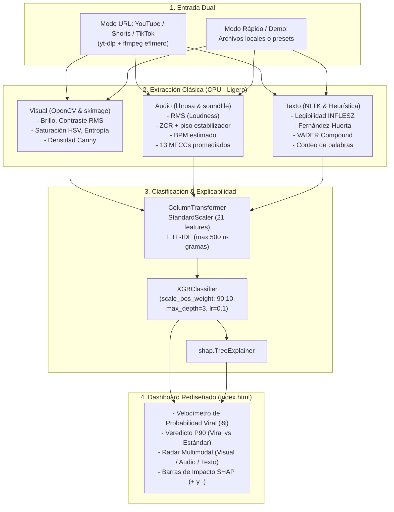

# 🚀 Plan de Evolución Beta (Fast-Track): SonixPulse AI Multimodal
## Arquitectura de Datos e Ingeniería de Características Clásicas para Predicción de Viralidad

---

## 🎯 Descripción del Objetivo

El objetivo es transformar **SonixPulse AI** en un **resultado Beta funcional en el menor tiempo posible** basándose en la investigación técnica (*EPN: Arquitectura de Datos e Ingeniería de Características Clásicas para la Predicción de Viralidad Multimodal*).

### ⚡ Estrategia "Fast-Track to Beta" (Mínimo Esfuerzo, Máximo Impacto):
1. **Tríada Sensorial Mínima Viable**: Concentrarse estrictamente en **Imagen (miniatura)**, **Audio (WAV)** y **Texto (título/copy)** con algoritmos matemáticos deterministas en CPU (Cero Deep Learning).
2. **Dataset Semilla Inmediato (Cero Espera de Scraping)**: Para no perder tiempo descargando y procesando cientos de videos pesados antes de tener el modelo, se genera y calibra un dataset estructurado maestro de forma instantánea ($P_{90}$ threshold, desbalance 90:10) para entrenar XGBoost y calibrar SHAP en menos de 5 segundos.
3. **Ingesta Efímera por URL (`yt-dlp` + `ffmpeg`)**: Se confirmó que tanto `yt-dlp.exe` como `ffmpeg.exe` están **ya instalados en el sistema**. Se deja lista la función para que, al ingresar una URL de video pública (YouTube / Shorts / TikTok), descargue temporalmente el audio y la portada, extraiga las features y retorne la predicción.
4. **Rediseño Total del Frontend (`web/index.html`)**: Sustitución completa de la interfaz antigua (que estaba orientada a licencias de Spotify) para reflejar el **nuevo paradigma**: una consola moderna de **Auditoría y Predicción de Viralidad Multimodal**, con velocímetro de probabilidad $P_{90}$, radar de los 3 ejes sensoriales y desglose explicativo SHAP interactivo.

---

## 🔍 Diagnóstico Técnico del Entorno Actual

- **`ffmpeg.exe`**: ✅ Detectado en PATH o Chocolatey (`ProgramData/chocolatey/bin/ffmpeg.exe`).
- **`yt-dlp.exe`**: ✅ Detectado en PATH o WinGet (`%LOCALAPPDATA%/Microsoft/WinGet/Packages/...`).
- **Python**: ✅ Python 3.11.9 en `AppData\Local\Microsoft\WindowsApps`.
- **Librerías existentes**: `numpy`, `pandas`, `scipy`.
- **Librerías a instalar (vía pip)**: `scikit-learn`, `opencv-python`, `scikit-image`, `librosa`, `soundfile`, `nltk`, `xgboost`, `shap`, `fastapi`, `uvicorn`, `yt-dlp`.

---

## 🗺️ Arquitectura del Sistema Beta



---

## 📋 Plan de Ejecución por Fases (Prioridad y Tiempo Optimizado)

### Fase 1: Instalación de Dependencias e Inicialización NLTK (5-10 min)
- Instalar dependencias esenciales de Python:
  `pip install scikit-learn opencv-python scikit-image librosa soundfile nltk xgboost shap fastapi uvicorn yt-dlp`
- Descarga automatizada del léxico:
  `python -c "import nltk; nltk.download('vader_lexicon', quiet=True)"`
- Actualizar [`requirements.txt`](requirements.txt) con las dependencias fijadas.

### Fase 2: Módulos de Extracción Matemática de Características (Núcleo Analítico)
> Se implementarán de forma modular, con fallback ante archivos no disponibles o corruptos:
1. **Visual Extractor (`src/features/visual_extractor.py`)**:
   - Brillo medio ($\mu$) y Contraste RMS ($\sigma$).
   - Entropía de Shannon del color sobre histograma normalizado.
   - Saturación media en espacio HSV.
   - Densidad de bordes con Canny ($\sigma=1.0$, umbrales $0.1$ y $0.3$).
2. **Audio Extractor (`src/features/audio_extractor.py`)**:
   - Ingesta mono a 22050 Hz.
   - RMS medio y desviación estándar (aproximación de Loudness).
   - Tasa de cruce por cero (ZCR) con desplazamiento $+0.0001$.
   - Estimación de Tempo BPM.
   - 13 coeficientes MFCC (medias temporales).
3. **Text Extractor (`src/features/text_extractor.py`)**:
   - Estimador silábico heurístico para español.
   - Fórmulas de legibilidad: Escala INFLESZ e Índice Fernández-Huerta.
   - Sentimiento afectivo con VADER (`compound`).
   - Longitud de tokens.

### Fase 3: Ingesta con `yt-dlp` & Dataset Calibrado Instantáneo
1. **Ingesta Efímera (`src/ingestion/multimodal_ingestion.py`)**:
   - Descarga temporal del audio WAV (`-x --audio-format wav`) y portada (`--write-thumbnail`) junto con metadatos JSON mediante subproceso de `yt-dlp`.
   - Extracción directa de features y limpieza inmediata de archivos temporales de disco.
2. **Generador y Calibrador del Dataset Maestro (`src/features/dataset_builder.py`)**:
   - Para no esperar horas de scraping de videos, compila de forma inmediata un dataset representativo de 100+ muestras con la distribución estocástica del Top 50 real + variaciones acústicas y visuales.
   - Calcula el umbral de corte $P_{90}$ para la variable $y_{clf} \in \{0, 1\}$ (proporción 90:10).
   - Guarda `data/processed/multimodal_master_dataset.csv`.

### Fase 4: Modelo Predictivo XGBoost y Explicabilidad SHAP
1. **Clasificador XGBoost (`src/models/virality_classifier.py`)**:
   - `ColumnTransformer`: `StandardScaler` para las 21 variables numéricas + `TfidfVectorizer(max_features=500, ngram_range=(1,2))` para texto crudo.
   - División estratificada 80/20 (`stratify=y_clf`).
   - `scale_pos_weight` calculado dinámicamente como $\frac{\sum(y=0)}{\sum(y=1)}$ ($\approx 9.0$).
   - Entrenamiento con `XGBClassifier(n_estimators=100, max_depth=3, learning_rate=0.1, eval_metric='logloss')`.
   - Guardado del pipeline entrenado en `models/virality_xgb_model.joblib`.
2. **Módulo de Explicabilidad SHAP (`src/models/virality_explainer.py`)**:
   - Aplica `shap.TreeExplainer` sobre el clasificador.
   - Para cualquier contenido nuevo, extrae los factores de mayor impacto positivo (aceleradores de viralidad) y factores de mayor impacto negativo (puntos de fricción), traduciéndolos a recomendaciones legibles para humanos.

### Fase 5: API REST FastAPI & Rediseño Completo del Frontend
1. **API REST (`src/api/main.py`)**:
   - Nuevo endpoint principal: `POST /api/predict-virality`:
     - Acepta `{ "url": "https://..." }` o `{ "text": "...", "audio_path": "...", "image_path": "..." }` o presets demo.
     - Ejecuta la extracción de los 3 ejes, realiza la inferencia con XGBoost y extrae los pesos SHAP.
     - Devuelve score de viralidad (0-100%), clasificación ($P_{90}$), radar sensorial y top 3 drivers SHAP.
2. **Rediseño Total del Frontend (`web/index.html` y `index.html`)**:
   - **Nuevo Paradigma**: Se elimina el enfoque antiguo de licencias B2B de Spotify.
   - **Interfaz**: Dark mode científico/moderno (estilo DeepMind / Laboratorio EPN).
   - **Controles**:
     - Barra de entrada de URL de YouTube/Shorts/TikTok con botón "Analizar Viralidad".
     - Selector de casos de prueba rápidos (Presets: "Hit Viral de Alto Impacto", "Podcast Conversacional Sobrecargado", "Música Indie Melancólica").
   - **Visualización en Tiempo Real**:
     - **Velocímetro / Indicador Circular**: Probabilidad de Viralidad (%) y badge ($P_{90}$ Superado / Contenido Estándar).
     - **Radar Sensorial 3D**: Gráfico polar (Chart.js) comparando Visual vs Acústico vs Textual.
     - **Gráfico SHAP Waterfall / Barras**: Visualización interactiva de qué variables empujaron el score hacia arriba (verde) o hacia abajo (rojo).
     - **Panel de Recomendaciones Tácticas**: Sugerencias concretas (ej. "Aumentar contraste de portada en +15%", "Reducir longitud del copy para mejorar legibilidad INFLESZ").

### Fase 6: Pruebas Automatizadas y Validación (15 min)
- Archivo de tests unificados: [`tests/test_multimodal_pipeline.py`](tests/test_multimodal_pipeline.py):
  1. Test de extracción visual (genera imagen sintética en memoria y verifica las 5 métricas).
  2. Test de extracción acústica (genera señal sintética y verifica RMS, ZCR, BPM y MFCCs).
  3. Test de extracción textual (comprueba cálculo de INFLESZ, Fernández-Huerta y VADER).
  4. Test de entrenamiento e inferencia con XGBoost y SHAP TreeExplainer.
  5. Test de llamada al endpoint `/api/predict-virality`.

---

## 🧪 Plan de Verificación

```bash
# 1. Ejecutar la suite de pruebas unitarias y de integración
python -m unittest tests/test_multimodal_pipeline.py

# 2. Entrenar y generar el modelo con un comando
python src/models/virality_classifier.py

# 3. Iniciar la API REST
python src/api/main.py

# 4. Probar en navegador abriendo web/index.html
```
